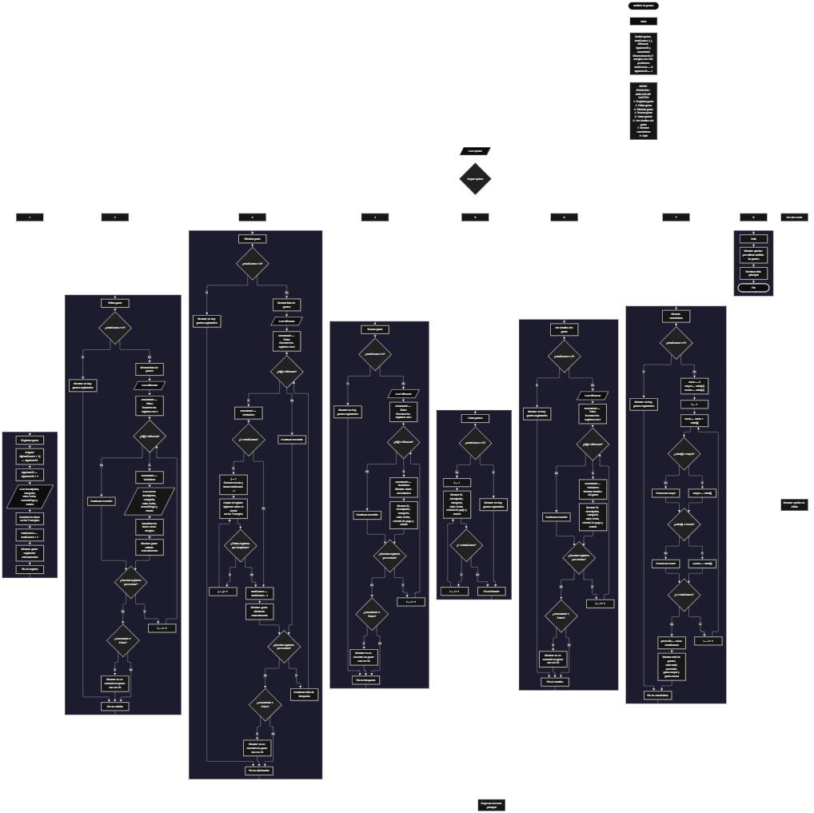

 

Este proyecto, llamado <b>análisis de gastos</b>, fue desarrollado en <b>pseint</b> como un ejercicio práctico para fortalecer la lógica de programación mediante la creación de un sistema de gestión de gastos desde la consola. El programa cuenta con un menú principal de ocho opciones que permite <b>registrar, editar, eliminar, buscar, listar y consultar los detalles</b> de los gastos almacenados, además de calcular estadísticas generales. Cada gasto contiene información como su descripción, categoría, valor, fecha, método de pago y estado. Para organizar estos datos, se utilizan arreglos con una capacidad declarada de <b>100 posiciones</b> durante la ejecución del programa. En su desarrollo se aplican conceptos fundamentales de programación, como variables, arreglos, estructuras condicionales, ciclos repetitivos y estructuras de selección, junto con procesos para buscar, modificar, eliminar y reorganizar registros. Este proyecto permite poner en práctica los conocimientos adquiridos en PSeInt y sirve como base para desarrollar sistemas de gestión más avanzados utilizando otros lenguajes y tecnologías.

<h2 align="center">⚙️ Funcionamiento del menú principal</h2>

### ➕ Registrar gasto

La opción <b>1) registrar gasto</b> permite agregar un nuevo gasto al sistema. Al seleccionar esta opción, el programa asigna un identificador utilizando el arreglo <b>id</b> y la variable <b>siguienteID</b>. Inicialmente, el identificador comienza en <b>1</b> y aumenta en uno después de cada asignación. A continuación, solicita la <b>descripción, categoría, valor, fecha, método de pago y estado</b> del gasto, almacenando cada dato en la posición correspondiente de sus respectivos arreglos. Cuando termina de solicitar la información, aumenta la variable <b>totalGastos</b> en uno y muestra el mensaje <b>"gasto registrado correctamente."</b>. El código dispone de arreglos de 100 posiciones, pero no incluye una comprobación que impida registrar gastos cuando se alcanza esa capacidad.

### ✏️ Editar gasto

La opción <b>2) editar gasto</b> permite modificar la información de un gasto previamente registrado. Primero, el programa comprueba si la variable <b>totalGastos</b> es igual a cero. Si no existen registros, muestra el mensaje <b>"no hay gastos registrados."</b>. En caso contrario, presenta una lista con el ID, la descripción, la categoría, el valor, la fecha, el método de pago y el estado de cada gasto. Después, solicita el identificador del gasto que se desea editar y establece la variable lógica <b>encontrado</b> en <b>falso</b>. Mediante un ciclo <b>para</b>, recorre los registros y compara cada identificador con el valor introducido por el usuario. Si encuentra una coincidencia, cambia <b>encontrado</b> a <b>verdadero</b>, solicita los nuevos datos del gasto y actualiza los arreglos correspondientes. Finalmente, muestra el mensaje <b>"gasto editado correctamente."</b>. Si no encuentra el identificador solicitado, presenta el mensaje <b>"no se encontró un gasto con ese id."</b>.

### 🗑️ Eliminar gasto

La opción <b>3) eliminar gasto</b> permite eliminar un gasto mediante su identificador. Antes de comenzar, el programa comprueba si existen registros almacenados. Si no hay gastos, muestra el mensaje <b>"no hay gastos registrados."</b>. Si existen, presenta una lista con los datos de los gastos y solicita el ID que se desea eliminar. Después, inicializa la variable <b>encontrado</b> en <b>falso</b> y recorre los registros mediante un ciclo <b>para</b>. Cuando encuentra el identificador solicitado, establece la variable en <b>verdadero</b>. Si el registro no ocupa la última posición, utiliza un segundo ciclo controlado por la variable <b>j</b> para desplazar una posición hacia atrás los datos de los arreglos <b>id, descripcion, categoria, valor, fecha, metodoPago y estado</b>. Posteriormente, disminuye <b>totalGastos</b> en uno y muestra el mensaje <b>"gasto eliminado correctamente."</b>. Si no se encuentra el ID, muestra el mensaje <b>"no se encontró un gasto con ese id."</b>. El código no limpia explícitamente la última posición después del desplazamiento ni interrumpe el recorrido tras eliminar un registro.

### 🔎 Buscar gasto

La opción <b>4) buscar gasto</b> permite localizar un gasto mediante su identificador. Primero, el programa verifica si existen registros. Si la cantidad de gastos es cero, muestra el mensaje <b>"no hay gastos registrados."</b>. De lo contrario, solicita el ID que se desea buscar e inicializa la variable lógica <b>encontrado</b> con el valor <b>falso</b>. A continuación, utiliza un ciclo <b>para</b> para recorrer los identificadores almacenados y compararlos con el valor introducido. Cuando encuentra una coincidencia, cambia la variable a <b>verdadero</b>, muestra el mensaje <b>"datos encontrados"</b> y presenta el ID, la descripción, la categoría, el valor, la fecha, el método de pago y el estado del gasto. Si termina el recorrido sin encontrar coincidencias, presenta el mensaje <b>"no se encontró un gasto con ese id."</b>.

### 📋 Listar gastos

La opción <b>5) listar gastos</b> permite visualizar todos los gastos registrados durante la ejecución del programa. Primero, comprueba si <b>totalGastos</b> es igual a cero. Si no existen registros, muestra el mensaje <b>"no hay gastos registrados."</b>. En caso contrario, presenta el encabezado <b>"datos registrados"</b> y utiliza un ciclo <b>para</b> para recorrer las posiciones comprendidas entre la primera y la última ocupada. En cada iteración, muestra el ID, la descripción, la categoría, el valor, la fecha, el método de pago y el estado de cada gasto. Esta opción permite consultar todos los registros disponibles sin tener que buscar cada gasto individualmente.

### 📄 Ver detalles del gasto

La opción <b>6) ver detalles del gasto</b> permite consultar individualmente toda la información de un gasto específico. Al seleccionar esta opción, el programa comprueba si existen registros. Si no hay gastos almacenados, presenta el mensaje <b>"no hay gastos registrados."</b>. Si existen, solicita el ID del gasto que se desea consultar, inicializa <b>encontrado</b> en <b>falso</b> y recorre los identificadores mediante un ciclo <b>para</b>. Cuando encuentra una coincidencia, cambia la variable a <b>verdadero</b> y muestra el encabezado <b>"detalles del gasto"</b>. Después, presenta cada campo por separado: <b>ID, descripción, categoría, valor, fecha, método de pago y estado</b>. Si no encuentra el registro solicitado, muestra el mensaje <b>"no se encontró un gasto con ese id."</b>.

### 📊 Mostrar estadísticas

La opción <b>7) mostrar estadísticas</b> permite calcular información general sobre los gastos registrados. Primero, comprueba si existen gastos almacenados. Si la variable <b>totalGastos</b> es igual a cero, muestra el mensaje <b>"no hay gastos registrados."</b>. En caso contrario, inicializa la variable <b>suma</b> en cero y utiliza el primer valor registrado para inicializar las variables <b>mayor</b> y <b>menor</b>. Después, recorre los gastos con un ciclo <b>para</b>, acumula cada importe en <b>suma</b> y compara los valores para identificar el gasto de mayor y menor importe. Al terminar el recorrido, calcula el promedio mediante la operación <b>promedio = suma / totalGastos</b>. Finalmente, muestra el total de gastos registrados, el valor total acumulado, el promedio de los gastos, el gasto mayor y el gasto menor. Estas variables estadísticas se utilizan en el código, aunque no aparecen declaradas en la sección inicial de variables compartida.

### 🚪 Salir del menú principal

La opción <b>8) salir</b> permite finalizar el uso del programa y muestra el mensaje <b>"gracias por utilizar analisis de gastos."</b>. El menú principal se encuentra dentro de una estructura repetitiva <b>repetir ... hasta que</b>, que mantiene el sistema en funcionamiento mientras el usuario realiza las operaciones disponibles. En el código, la condición de salida es <b>hasta que opcion = 8</b>, por lo que coincide con el número asignado a la opción de salida. Una vez que se selecciona esta opción, el ciclo termina y finaliza la ejecución del algoritmo.

<h2 align="center">🧠 Temas aplicados en el proyecto</h2>

### 📦 Variables

En este proyecto se utilizan variables para controlar el menú, administrar la cantidad de gastos registrados, asignar identificadores, recorrer los arreglos, buscar registros y calcular estadísticas. Cada variable cumple una función dentro de las operaciones de gestión de gastos. Las variables declaradas inicialmente y las utilizadas posteriormente en los cálculos permiten organizar la información y controlar el funcionamiento del algoritmo.

🔢 **Opcion:** Almacena el número de la opción seleccionada en el menú principal.

📊 **TotalGastos:** Controla la cantidad actual de gastos registrados.

🔄 **I:** Se utiliza como contador para recorrer los arreglos y acceder a los datos de cada gasto.

🔁 **J:** Controla el desplazamiento de los registros durante la eliminación de un gasto.

🆔 **SiguienteID:** Asigna identificadores consecutivos a los nuevos gastos.

🔎 **IdBuscar:** Almacena el identificador introducido para buscar, editar, eliminar o consultar un gasto.

✅ **Encontrado:** Variable lógica que indica si se localizó el identificador solicitado.

🧮 **Suma:** Acumula los valores de los gastos para calcular el importe total.

📈 **Mayor:** Almacena el importe más alto encontrado durante el cálculo de estadísticas.

📉 **Menor:** Almacena el importe más bajo encontrado durante el cálculo de estadísticas.

📊 **Promedio:** Almacena el promedio de los valores registrados.

### 🗃️ Arreglos

El programa utiliza siete arreglos dimensionados con <b>100 posiciones</b> para almacenar los datos de los gastos. Todos utilizan el mismo índice para relacionar la información de un registro. Por ejemplo, los datos del gasto situado en la posición <b>1</b> se encuentran distribuidos entre <b>id[1], descripcion[1], categoria[1], valor[1], fecha[1], metodoPago[1] y estado[1]</b>. Esta organización permite recorrer los registros y realizar las operaciones de consulta, modificación y eliminación. La cantidad de posiciones consideradas ocupadas se controla mediante la variable <b>totalGastos</b>.

🆔 **Id[100]:** Almacena el identificador de cada gasto.

📝 **Descripcion[100]:** Guarda la descripción de los gastos registrados.

🏷️ **Categoria[100]:** Almacena la categoría de cada gasto.

💰 **Valor[100]:** Guarda el importe correspondiente a cada gasto.

📅 **Fecha[100]:** Almacena la fecha asociada al gasto.

💳 **MetodoPago[100]:** Guarda el método de pago utilizado.

📌 **Estado[100]:** Almacena el estado introducido para cada gasto.

### 🔀 Estructuras condicionales

Las estructuras <b>si ... entonces</b> y <b>si ... sino</b> permiten comprobar las condiciones necesarias para ejecutar las operaciones. Se utilizan para verificar si existen gastos registrados antes de buscar, editar, eliminar, listar o consultar información; comparar los identificadores introducidos con los almacenados; y determinar si un importe es mayor o menor que los valores encontrados anteriormente. También permiten comprobar si el gasto que se desea eliminar ocupa una posición anterior a la última, para decidir si es necesario desplazar los registros posteriores.

### 🔄 Estructuras repetitivas

El programa utiliza los ciclos <b>para</b> y <b>repetir ... hasta que</b>. Los ciclos <b>para</b> permiten recorrer los arreglos para mostrar los gastos, buscar identificadores, actualizar información y calcular estadísticas. Durante la eliminación, se emplea un ciclo adicional para desplazar los datos de las posiciones posteriores. Por otro lado, el ciclo <b>repetir ... hasta que</b> mantiene activo el menú principal hasta que la opción seleccionada es igual a <b>8</b>, permitiendo ejecutar varias operaciones durante una misma sesión.

### 🎯 Estructura según

La estructura <b>segun ... hacer</b> evalúa el valor almacenado en la variable <b>opcion</b> y ejecuta las instrucciones correspondientes a la operación seleccionada. Los casos del <b>1 al 8</b> representan el registro, la edición, la eliminación, la búsqueda, el listado, la consulta de detalles, las estadísticas y la salida del sistema. Además, el bloque <b>de otro modo</b> muestra el mensaje <b>"opción no válida."</b> cuando el usuario introduce un número que no coincide con ninguna de las opciones definidas.

### 🔢 Dimensionamiento de arreglos

La instrucción <b>dimension</b> establece la capacidad de los siete arreglos utilizados para guardar la información de los gastos. Cada arreglo se dimensiona con <b>100 posiciones</b>, lo que establece la capacidad declarada para los registros durante la ejecución. La variable <b>totalGastos</b> indica cuántos registros se consideran activos, mientras que <b>siguienteID</b> mantiene la secuencia de identificadores asignados. El código no incorpora una comprobación para impedir registros adicionales cuando se alcanza la capacidad de los arreglos.

### 🔄 Reorganización de registros

Durante la eliminación de un gasto, el programa comprueba si la posición encontrada es menor que <b>totalGastos</b>. Si existen registros posteriores, utiliza un ciclo controlado por <b>j</b> para copiar los datos de la posición siguiente a la posición actual. Este desplazamiento se realiza en los siete arreglos: <b>id, descripcion, categoria, valor, fecha, metodoPago y estado</b>. Una vez terminado el desplazamiento, la variable <b>totalGastos</b> disminuye en uno. Aunque los registros activos quedan desplazados para ocupar las posiciones anteriores, el código no borra explícitamente los datos que permanecen en la última posición física del arreglo.

<h2 align="center">¿Cómo se implementaron las operaciones CRUD en el proyecto?</h2>

Las operaciones <b>CRUD</b> se distribuyen entre las opciones del menú principal. La operación <b>crear</b> corresponde a <b>registrar gasto</b>, que asigna un identificador y almacena los datos introducidos. La operación <b>leer</b> se implementa mediante <b>buscar gasto, listar gastos y ver detalles del gasto</b>, que permiten consultar los registros almacenados. La operación <b>actualizar</b> corresponde a <b>editar gasto</b>, donde se modifican los datos de un registro identificado por su ID. Finalmente, la operación <b>eliminar</b> corresponde a <b>eliminar gasto</b>, que reduce la cantidad de registros y desplaza los datos posteriores para reorganizar los arreglos. Estas operaciones permiten administrar la información de los gastos de manera estructurada durante la ejecución del programa.

<h2 align="center">Diagrama de flujo del proyecto</h2>

<h2 align="center">🛡️ Validaciones del programa</h2>

### 📭 No existen gastos registrados

Esta comprobación se utiliza en las opciones de <b>editar, eliminar, buscar, listar, ver detalles y mostrar estadísticas</b>. El programa verifica si <b>totalGastos</b> es igual a <b>0</b>. Si no existen registros, muestra el mensaje <b>"no hay gastos registrados."</b> y evita continuar con la operación que necesita información almacenada. Esta condición permite controlar las situaciones en las que el usuario intenta consultar o administrar una lista vacía.

### 🔎 Gasto no encontrado

En las operaciones de edición, eliminación, búsqueda y consulta de detalles, el programa inicializa la variable <b>encontrado</b> con el valor <b>falso</b> y recorre los registros comparando los identificadores almacenados con el ID introducido por el usuario. Cuando encuentra una coincidencia, cambia la variable a <b>verdadero</b> y ejecuta las instrucciones correspondientes. Si el recorrido termina sin encontrar el gasto, muestra el mensaje <b>"no se encontró un gasto con ese id."</b>. Esta comprobación permite informar al usuario cuando el identificador solicitado no coincide con ningún registro encontrado durante el recorrido.

### ⚠️ Capacidad de los arreglos

Los arreglos del programa están dimensionados con <b>100 posiciones</b>. Sin embargo, el código actual no comprueba si <b>totalGastos</b> ha alcanzado ese límite antes de registrar otro gasto. Por tanto, no se puede afirmar que exista una validación de capacidad máxima. Para evitar accesos fuera de las posiciones disponibles, sería necesario incorporar una condición que compruebe la cantidad de registros antes de permitir una nueva inserción.

### 💰 Valores y datos introducidos

El programa solicita la descripción, categoría, valor, fecha, método de pago y estado de cada gasto, pero el código compartido no incluye comprobaciones explícitas para validar que los campos estén completos, que el importe sea positivo o que la fecha tenga un formato válido. Los datos se almacenan según los valores introducidos por el usuario. Por ello, estas comprobaciones no deben considerarse funcionalidades implementadas en la versión actual.

### ⚠️ Variables de las estadísticas

La sección de estadísticas utiliza las variables <b>suma, mayor, menor y promedio</b> para calcular los resultados, pero estas no aparecen declaradas en la sección inicial del código proporcionado. Aunque el algoritmo contiene las operaciones de cálculo, conviene declarar explícitamente estas variables para mantener la estructura del programa organizada y facilitar su revisión y ejecución en PSeInt.

### 🔢 Opción inválida

La estructura <b>segun</b> incluye un bloque <b>de otro modo</b> que muestra el mensaje <b>"opción no válida."</b> cuando el número introducido no corresponde a las opciones del menú principal. La salida del programa está asociada a la opción <b>8</b>, y la condición del ciclo repetitivo también utiliza <b>opcion = 8</b>. De esta manera, el número de la opción de salida coincide con la condición que termina el menú.

<h2 align="center">🎯 Objetivo del proyecto</h2>

El objetivo principal de este proyecto es fortalecer la <b>lógica de programación</b> mediante el desarrollo de un sistema de gestión de gastos en <b>pseint</b>. A través de su construcción se aplican conocimientos sobre variables, arreglos, estructuras condicionales, ciclos repetitivos y estructuras de selección. Además, permite comprender cómo registrar, consultar, modificar y eliminar información, organizar registros mediante el desplazamiento de arreglos y obtener estadísticas a partir de datos numéricos. El proyecto constituye una práctica de programación estructurada que puede servir como base para desarrollar sistemas de gestión más completos utilizando otros lenguajes y tecnologías.

